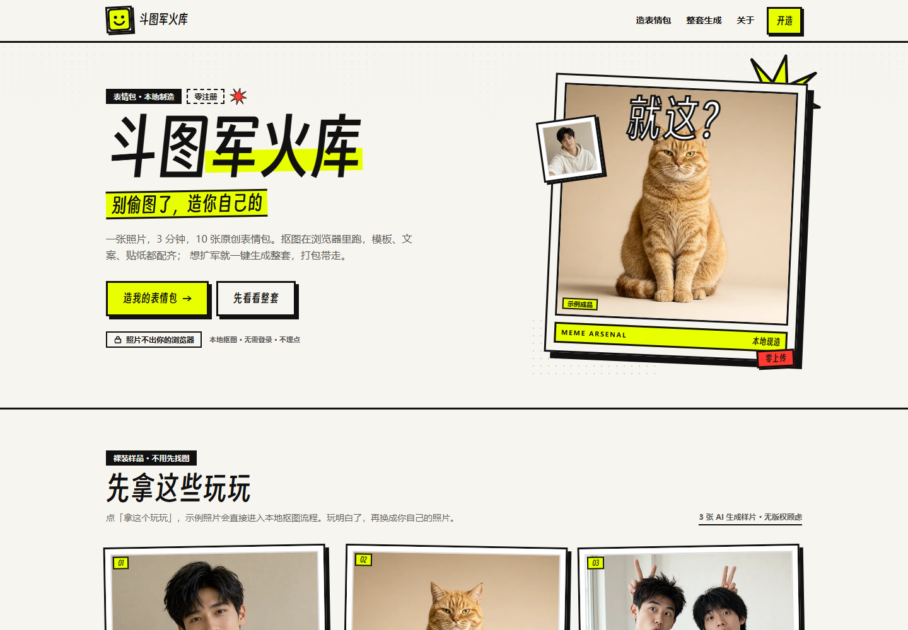
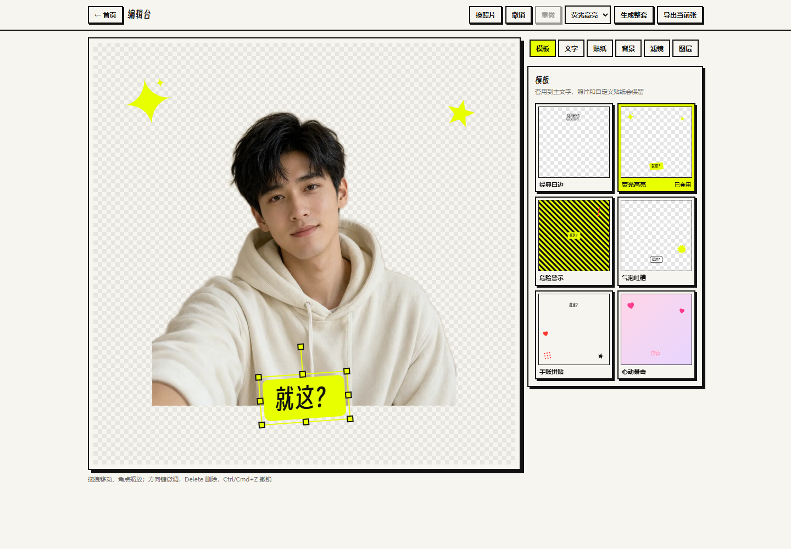
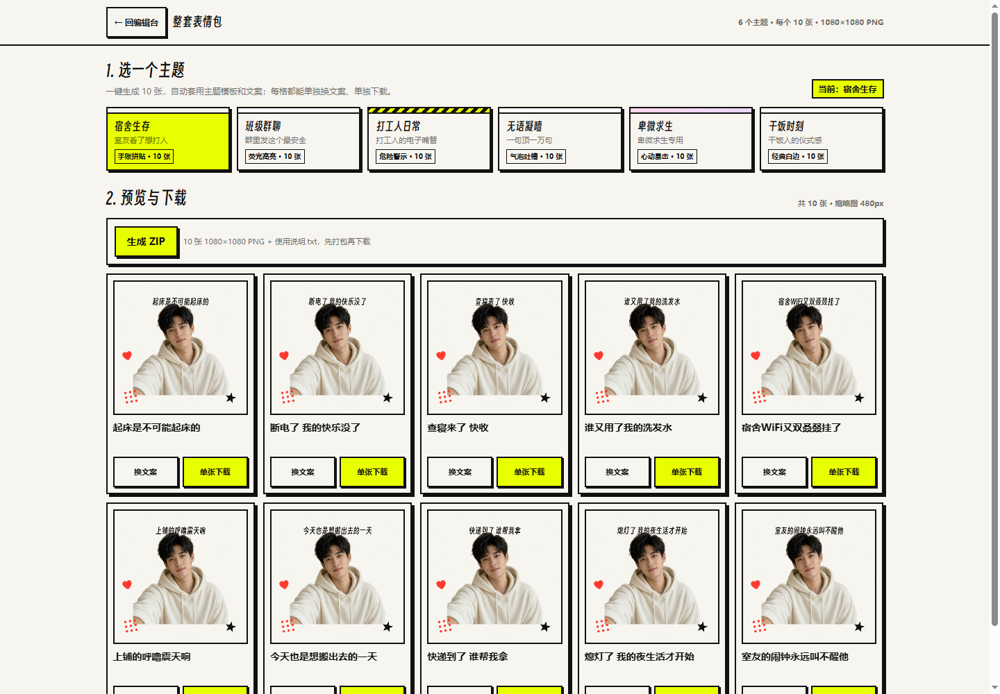

# 斗图军火库（MemeArsenal）

2026 Qoder 高校创造力大赛 · LifeHack 赛道参赛作品。所有内容集中在仓库根目录，设计、代码、素材与提交材料可多端协作。

**在线体验：** https://meme-arsenal-h9ls3oya5li.qoder.zone（最终部署，2026-10-29 已实测匿名访问正常）

上传一张照片，3 分钟造出一整套原创表情包。抠图在浏览器本地完成，照片不上传服务器。

## 功能

- 本地一键抠图（u2netp ONNX + onnxruntime-web，模型与运行时自托管）
- 6 套视觉模板、22 个矢量贴纸、60 条原创文案
- Konva 画布编辑：拖拽/缩放/旋转、撤销重做、图层、滤镜
- 6 个情绪主题整套生成（每主题 10 张），单格换文案
- 单张 1080×1080 透明底 PNG；整套 ZIP 下载
- 移动端底部标签栏 + 底部面板；桌面左右分栏
- 草稿自动保存到 IndexedDB，刷新可恢复
- 零注册、零上传、零埋点

## 截图

| 首页 | 编辑器 | 整套生成 |
| --- | --- | --- |
|  |  |  |

更多验收截图见 `docs/assets/`（移动端、降级模式、ZIP 导出等）。

## 仓库结构

```
apps/meme-factory/              # Vite + React + TS 应用
  src/features/cutout/          # 本地抠图推理
  src/features/editor/          # Konva 编辑器与面板
  src/features/packs/           # 整套生成与 ZIP
  src/lib/render.ts             # 共享 Canvas 渲染器（编辑/导出同源）
  src/data/                     # 模板、贴纸、文案库
  public/models/                # u2netp.onnx（4.6MB，Apache-2.0）
  public/samples/               # AI 生成示例照片
docs/
  spec-2026-10-29-meme-factory-design.md          # 设计文档
  superpowers/plans/2026-10-29-meme-factory.md    # 实现计划
  build-log.md                  # 开发日志（Qoder 使用过程）
  forum-post.md                 # 天池作品帖草稿
  assets/                       # 截图、验收清单、素材授权
```

## 本地运行

```bash
cd apps/meme-factory
npm install
npm run dev          # http://localhost:5173
npm run test         # Vitest（172 tests）
npm run build        # tsc + vite build
npm run fetch-model  # 重新下载 u2netp（可选，模型已提交）
```

要求 Node >=22.12（Vite 8 / Vitest 5；开发使用 Node 24）。详细说明见 `apps/meme-factory/README.md`。

## 技术要点

- 纯静态站点，无后端；照片数据不离开浏览器
- 抠图：320×320 CHW 预处理 → u2netp → 蒙版归一化 → 1px 羽化 → 合成 PNG
- 编辑与导出共用 `renderScene` 场景渲染器，保证所见即所得
- 中文字体自适应：按字符测量、自动降字号、最多两行、省略号兜底
- 模型按需加载并缓存到 Cache Storage；失败可跳过进入相框模式
- Hash 路由 + 相对 `base`，静态托管无深链 404 问题

## 赛事信息

- 比赛：2026 Qoder 高校创造力大赛（天池 532536）
- 赛道：LifeHack 生活娱乐
- 截止：2026-11-30 18:00 报名与提交
- 交付：Qoder Sites 公网链接 + 天池论坛作品帖

## 许可与素材

- 代码：本仓库
- 字体：Smiley Sans（OFL 1.1，`apps/meme-factory/src/assets/fonts/`）
- 抠图模型：U-2-Net / u2netp（Apache-2.0，`apps/meme-factory/public/models/`）
- 示例照片：AI 生成（见 `docs/assets/sample-licenses.md`）
- 文案与贴纸：原创
